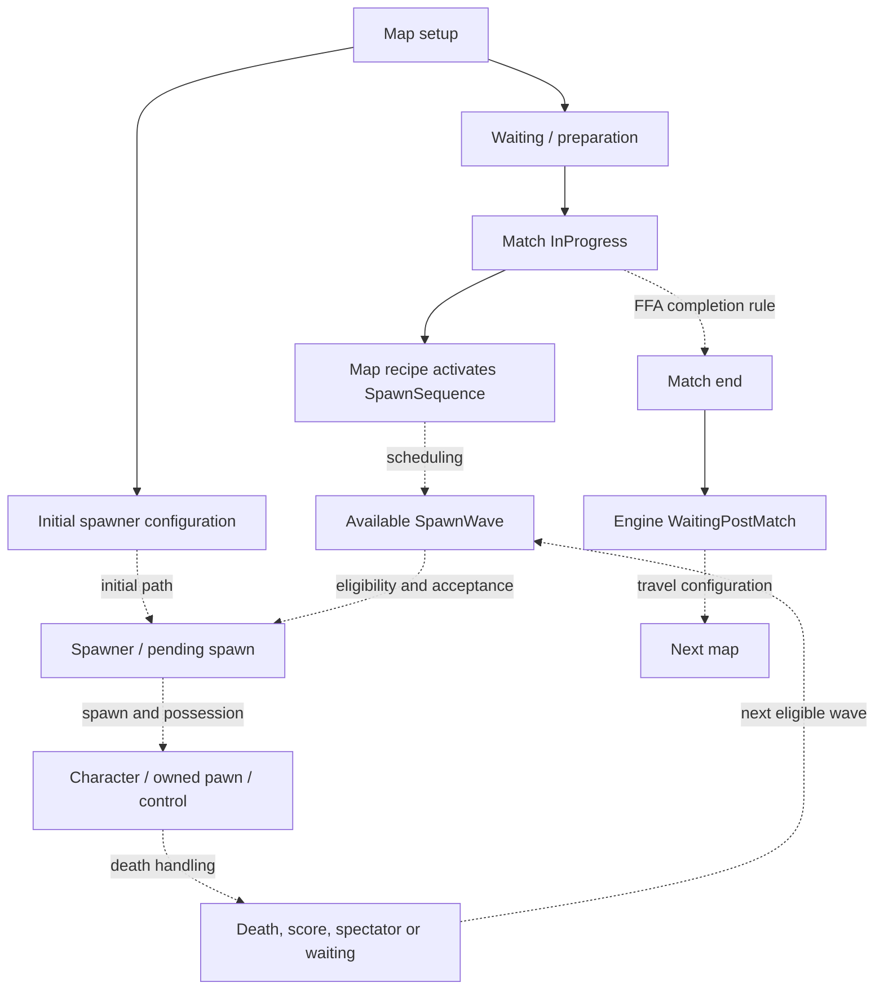

# Understanding an FFA match lifecycle

Evidence baseline: 2026-10-20. This guide combines inspected UE 4.25.4 engine source, ArgonSDK declarations, historical generated API references and bounded prior modding observations. It supplies a working model, not a recovered shipping implementation. No new runtime test was performed for this guide.

Engine baseline was UE 4.25.4 CL 14469661. ArgonSDK revision was `d9d9759e40e623a5f7f41d8c58ea8a2988170a26`; the generated reference revision was `a50e22bf4131783f530a0edd3c78e09e01d6cd3c`. These revisions do not identify or prove parity with a current retail executable.

## The objects have different jobs

| Object | Role established by declarations / engine architecture |
| --- | --- |
| World Settings | Map type/faction, initial spawners and cinematic sequence references |
| GameMode | Authoritative match rules, startup timing and spawn coordination |
| GameState | Shared match state, selected replicated timings and match notifications |
| PlayerController | Player requests, server/client RPCs, pawn and spectator/control interfaces |
| PlayerState | Player identity and score-related state, next-spawn class/team/loadout data |
| Character | Physical pawn with movement, damage/death and possession-related hooks |
| SpawnQueuer | Request/removal/activation interface for spawn eligibility/coordination |
| Spawner / GroupSpawner | Locations, reservations and spawning; groups select among child spawners |
| SpawnSequence | Spawner list and recurring wave scheduling controls |
| SpawnWave | Joined players, timing, wave state, spawn/possession and control restriction |

Source: [generated class references](https://github.com/Chiv2-Community/chiv2-tblcpp-obsidian-clean/tree/main/docs/SDK/Source/Classes) and [SDK declarations](https://github.com/Chiv2-Community/ArgonSDK/tree/d9d9759e40e623a5f7f41d8c58ea8a2988170a26/Source/TBL/Public). Inspect individual property metadata: not every field or event on a replicated actor is itself replicated.

## A connected model

The diagram describes responsibilities. Dotted edges are relationships whose exact TBL calls/order were not established by this study.

### 1. Map initialization is not match readiness

Select the intended game-mode class as well as FFA faction/type and initial spawner references. The initial-map recipe uses `/Game/GameModes/Modes/Mode_FFA`.

In inspected engine source, `AGameMode::StartPlay()` transitions EnteringMap to WaitingToStart and checks readiness. `StartMatch()` transitions to InProgress after the session has an opportunity to defer it. Actor BeginPlay can run while waiting to start. Activating gameplay merely because BeginPlay fired can therefore be premature.

TBL declares additional waiting/preparation/start hooks and separate minimum/maximum start waits, warmup and preparation fields. A warmup URL option is not proof that every startup timer is removed.

Use `IsMatchInProgress()` for an active-match gate. The inspected engine's `HasMatchStarted()` can remain true after active play has ended. If subscribing to a start event, also handle a match already in progress; otherwise late subscribers can miss the transition. Exact TBL event firing order remains unresolved. [GameMode reference](https://github.com/Chiv2-Community/chiv2-tblcpp-obsidian-clean/blob/main/docs/SDK/Source/Classes/classATBLGameMode.md).

### 2. Initial spawning needs a separate recurring path

The initial-only Field Guide tutorial does not establish repeated respawns. This is a configuration limitation, not proof that a spawner object can only ever spawn once. `ASpawner.StartSpawning` accepts a faction and parameter overrides and returns a **SpawnWave**, not a Character. [Node reference](https://github.com/Chiv2-Community/chiv2-tblcpp-obsidian-clean/blob/main/TBL_src_clean/Spawner/nodes/StartSpawning.md).

The [documented respawn recipe](spawns-and-navigation.md) adds a SpawnSequence and server-side match-state activation. Group selection, sequence cadence and each wave's join window are separate from a particular player's spawn delay.

`FSpawnWaveParamOverrides` pairs many values with `bOverride...` switches. A stored value without its enabled override does not establish the effective runtime setting. `SecondsJoinableAfterSpawningStarts` is a join window; do not equate it with `MinimumWaitTimeSeconds`, `SecondsBeforeSpawningStarts`, `PrespawnTime` or sequence `SecondsBetweenWaves`.

Earlier bounded tests retained positive wave cadence and a five-second join window while reducing player waits. An initial countdown still remained. That observation does not identify which timer caused the remaining delay.

### 3. A request, a body and control are separate outcomes

| Interface | Concrete facts | What is not proved |
| --- | --- | --- |
| `SpawnSequence.Activate()` | Returns bool; BlueprintCallable | Exact return conditions or internal scheduler |
| `SpawnWave.IsJoinableBy(Controller)` | Pure bool query | Complete eligibility policy |
| `SpawnWave.JoinSpawn(Controller)` | Authority-only Blueprint function returning bool | Successful possession |
| `RequestJoinSpawnWave(Wave, FromAutoSpawn)` | Cosmetic Blueprint-callable request interface | Exact internal call chain |
| `ServerJoinSpawnWave(Wave, FromAutoSpawn)` | Reliable Server RPC with validation declaration | Retail validation rules |
| `ClientNotifyWaveJoinResponse(Wave, Success)` | Reliable Client RPC | Ordering relative to all other state changes |
| `SpawnQueuer.RequestSpawnFor(Controller)` | BlueprintNativeEvent returning bool | Behavior of the selected subclass |
| `GameMode.PlayerReadyToSpawn(Queuer, Player, Spawner)` | Protected BlueprintCallable notification interface | That mods should invoke it directly |
| `PerformDeferredSpawnRequest(PendingSpawn)` | Record links queuer, wave, spawner, controller and reservation index | Exact deferred scheduling algorithm |
| `Spawner.SpawnCharacter(Transform, Class, Controller)` | Returns Character | Camera/input readiness |
| `ClientNotifyPendingSpawn(Spawner, ServerSpawnTime)` | Reliable scheduled-spawn notification | That the character already exists |
| `ClientSpawnerStartAllowingControl(Spawner, Character)` | Reliable Client RPC | A substitute for possession or eligibility |
| `GetRespawnTime()` | Exec pins, bool return and float out parameter | Exact bool meaning or delay formula |

Sources: [SpawnWave](https://github.com/Chiv2-Community/chiv2-tblcpp-obsidian-clean/blob/main/docs/SDK/Source/Classes/classASpawnWave.md), [PlayerController](https://github.com/Chiv2-Community/chiv2-tblcpp-obsidian-clean/blob/main/docs/SDK/Source/Classes/classATBLPlayerController.md), and SDK headers for RPC/authority metadata. The [GetRespawnTime node](https://github.com/Chiv2-Community/chiv2-tblcpp-obsidian-clean/blob/main/TBL_src_clean/TBLPlayerController/nodes/GetRespawnTime.md) explicitly shows both outputs.

In the installed engine's generic restart path, `FinishRestartPlayer()` calls controller `Possess()`. Possession normally requires authority; the local player separately acknowledges its pawn. TBL also declares pending-possession characters and control-release interfaces. A visible body therefore does not prove an owned pawn, correct view target, acknowledged possession or usable input. Whether the custom TBL spawner follows every generic engine restart step is unresolved.

### 4. Death has several consumers

Character exposes `OnKilled`; GameState and GameScoringInfo expose `PlayerKilled`; PlayerState has replicated score/death fields; Controller has death, spectator and wave interfaces. These declarations identify the systems to inspect, but do not prove the order they call one another.

`GameState.BroadcastPlayerKilled` is declared as a reliable multicast RPC. `OnPlayerKilled` is a delegate. Do not treat every delegate as a replicated event.

The respawn loop requires a new eligible spawn opportunity. The exact death-to-queue transition, class/loadout/team checks and timing formula remain unresolved. Test respawn separately from initial spawn and from spectator transitions. [Scoring interface](https://github.com/Chiv2-Community/chiv2-tblcpp-obsidian-clean/blob/main/docs/SDK/Source/Classes/classATBLGameScoringInfo.md).

### 5. Match completion is game-specific

In the inspected engine, default `ReadyToEndMatch()` returns false. Game-specific logic must decide completion. `EndMatch()` moves active play to WaitingPostMatch; LeavingMap and travel are separate operations.

TBL exposes timeout/end hooks, post-match state and `OnMatchWonBy(EFaction Victor)`. That faction-valued argument is not an FFA winner's PlayerState. `TBSEndGame(int32 WinningTeam)` likewise does not document winning-player encoding. Exact FFA score/time limits, tie handling, podium behavior and next-map precedence were not established here.

## How to use the evidence

Many SDK C++ bodies are empty reconstructed stubs. For example, `SpawnSequence.Activate()` returns false and a controller RPC validator returns true in the inspected SDK. Neither value establishes retail behavior. A function declaration proves an interface; a node image proves its represented pins; real implementation or a bounded observation is needed for behavior.

Keep the following unresolved until stronger evidence exists:

- Effective FFA queuer/stage subclasses and inherited settings.
- Actual request-to-spawn call order and wave rejection rules.
- Residual initial-countdown cause and complete delay precedence.
- Late-join and remote-server behavior beyond prior limited observations.
- Winner selection, ties, match completion and travel rules.

Troubleshoot at the failing boundary: initial reference/slots for no first spawn; recurring sequence and eligibility for no respawn; possession/control for an inert body; completion rules for a match that never ends. Use the [practical recipe](spawns-and-navigation.md) alongside this model.

## Protected-session boundary

Static documentation research requires no running-game access. This study used no debugger attachment, injection, memory modification, executable patch, game installation change, authentication/backend experiment or EAC setting change. Future runtime investigation needs a separately authorized and verified environment; a local/offline label alone does not establish that instrumentation is safe. These precautions are not an EAC endorsement or a guarantee against enforcement.
